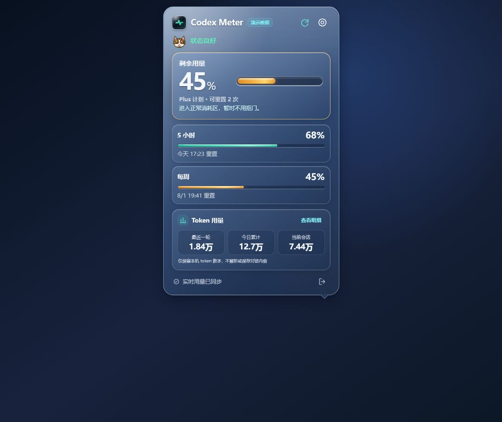

# Codex Meter

Codex Meter 是一款面向 Windows 系统托盘和 macOS 菜单栏的轻量用量查看工具，可分别开启 Codex 额度监测、Claude Code 用量监测与 Antigravity 额度监测。

它通过本机官方 `codex app-server` 读取当前 ChatGPT 账户的用量窗口，并使用平台适配的玻璃小猫状态图标与轻薄玻璃气泡面板展示剩余额度、重置时间和套餐类型。

## 当前状态

| 平台 | 状态 | 产物 |
| --- | --- | --- |
| Windows 10/11 | 已完成首个可验证版本 | `codex-meter.exe` |
| macOS | 由 GitHub Actions 构建，等待真机验收 | `.app` / `.dmg`（ad-hoc 签名） |

Windows 版本已验证生产构建、单实例、右键菜单、深色模式、窄尺寸布局和基础交互。macOS 仍需在真实 Mac 上验证菜单栏定位、Retina 缩放、Vibrancy 效果和应用签名。

## macOS 界面预览



> 使用项目内置演示数据生成，用于展示菜单栏面板界面；macOS 实机效果仍以真机验收为准。

## 主要功能

- 显示 Codex 5 小时和每周用量窗口。
- 显示本机 Claude Code 用量：当前 5 小时窗口、今日累计、当前会话和按模型汇总（主数字为输入加输出，不含缓存）。
- 可选的 Claude 订阅额度（5 小时与每周，含 Opus/Sonnet 每周窗口）：开启后使用 Claude Code 自己的登录凭据（macOS 钥匙串项 `Claude Code-credentials`，或 `~/.claude/.credentials.json`），向 Claude Code `/usage` 使用的同一接口查询，每 5 分钟一次（面板打开时 2 分钟）。访问令牌约 3 小时过期，Meter 会按 Claude Code 相同的方式自动续期：先取得 `~/.claude/.oauth_refresh.lock` 续期锁、在锁内重新读取凭据，再写回同一钥匙串项，保留其余字段；凭据不会上传到 Anthropic 以外的地方。需要先在终端安装并登录 `claude` 命令行；网络请求遵循 macOS 系统代理。该接口未公开文档，可能变化。
- 可选的 Antigravity 额度监测：默认关闭，开启后通过本机运行中的 Antigravity `language_server`（发现文件 `~/.gemini/antigravity/daemon/*.json`）向本地回环 ConnectRPC `GetUserStatus` 只读查询当前登录账户的剩余额度与重置时间（绕过系统代理，不触发模型推理）。支持按共享额度池分组展示（如 Gemini 共享池与 Claude / GPT 合作模型共享池）及展开查看各基础模型明细，并可作为单环托盘来源；当存在多个配额分组时，托盘单环以剩余比例最低的分组为准。
- Codex、Claude 与 Antigravity 各有独立的监测开关，可在卡片右上角或设置页切换；关闭的来源不再刷新、不占用后台进程。Codex 默认开启，Claude 与 Antigravity 默认关闭，设置重启后保留（兼容旧版 `monitoring.json`）。
- Windows 托盘只显示方形玻璃小猫，通过表情和耳朵姿态表达用量状态。
- macOS 菜单栏将玻璃小猫与进度条左右排列，同时表达状态和剩余额度。
- 小猫采用深蓝玻璃本体、霓虹状态轮廓、高光大眼和极简嘴型。
- 自动选择剩余比例更低的窗口作为托盘主状态。
- 展示本地时区下的额度重置时间。
- 接口支持时展示账户当前可用的额度重置次数。
- 根据剩余用量显示不同的轻松提示文案。
- 自动识别 Plus、Pro、Team、Business 等套餐名称。
- 后台线程负责刷新，面板收起时托盘也会更新：Codex 与 Antigravity 额度每分钟（面板打开时每 30 秒），本机 Token 每 10–30 秒，Claude 订阅额度每 5 分钟（面板打开时每 2 分钟）；打开面板、睡眠唤醒后立即刷新，也可手动刷新。
- 可在设置中开启“随系统登录启动”，默认关闭。
- 刷新失败时保留最后一次成功结果并标记为旧数据。
- 5 分钟内的短暂失败显示“正在重连”，超过 5 分钟才进入数据过期状态。
- 跟随系统浅色/深色模式。
- 支持上下左右任务栏、DPI 缩放和工作区边界限制。
- 点击窗口外部或按 `Esc` 自动收起面板。
- 单实例运行，重复启动只会唤起已有程序。

## 界面设计

- 轻薄玻璃质感：半透明背景、细边框、高光和柔和阴影。
- 气泡箭头自动指向托盘图标。
- 无标题栏、无任务栏窗口按钮、无浏览器右键开发菜单。
- 设置、加载、无数据、过期和错误状态均有明确反馈。

## 数据来源与准确性

Codex Meter 使用本机 Codex CLI 提供的 `codex app-server` JSON-RPC 接口：

```text
initialize
  → initialized
  → account/read
  → account/rateLimits/read
```

用量口径：

- 后端返回 `usedPercent`，界面展示 `remainingPercent = 100 - usedPercent`。
- 根据 `windowDurationMins` 识别 5 小时和每周窗口，不依赖返回数组顺序。
- 套餐类型优先采用实时 rate limits 响应，避免显示过期账户信息。
- `resetsAt` 按 Unix 秒解析，并使用系统时区显示。
- Token 摘要来自本机 Codex 会话文件中的独立 `token_count` 事件，通过累计值差分计算最近一轮、今日累计和当前会话。
- Antigravity 额度来自本机运行中的 Antigravity `language_server`（`~/.gemini/antigravity/daemon/*.json`）本地回环 `POST /exa.language_server_pb.LanguageServerService/GetUserStatus`：
  - 直接读取 `cascadeModelConfigData.clientModelConfigs[*].quotaInfo.remainingFraction`（`0.0`–`1.0`，转换为剩余百分比）与 `resetTime`（ISO-8601 UTC 时间戳，按本地时区显示）。
  - 接口不返回窗口时长，因此不套用 Codex/Claude 的 5 小时或每周窗口与时间进度刻度；若某模型缺少 `remainingFraction`，界面显示未知（`—`），不会猜测为 `0%` 或 `100%`。
  - 仅在同厂商大类且 `remainingFraction` 与 `resetTime` 精确一致时合并为共享额度分组，不同配额自动拆开显示，不做无依据平均。
  - 套餐名优先取 `userTier.name` / `description`（如 `Google AI Pro`）；仅在返回明确 `creditAmount` 时显示 `AI Credits`，不混用遗留 `availablePromptCredits` 占位字段。
  - 可通过环境变量 `CODEX_METER_ANTIGRAVITY_DAEMON_DIR` 指定自定义的 daemon 发现目录。

## 隐私与安全边界

- 不读取或复制 `~/.codex/auth.json`。
- 用量统计读取 `~/.codex/sessions` 和 `~/.codex/archived_sessions` 时只解析相关事件的类型、时间戳和 token 数字，不解析或保存提示词、回复与代码内容。
- 开启 Claude 监测后，只读取 `~/.claude/projects`（或 `CLAUDE_CONFIG_DIR`）下 Claude Code 记录中 assistant 消息的 usage 数字、时间戳、模型名和会话 ID，不保存对话内容；不读取 Claude 登录凭据。
- 开启 Antigravity 监测后，仅向本机回环 `127.0.0.1` 的 Antigravity `language_server` 发送只读状态查询，不提取浏览器 Cookie、不修改登录态、不触发模型推理；CSRF 令牌与账号邮箱/姓名仅限后端内存使用，不会传入前端、日志或缓存。
- 不保存 OpenAI access token、refresh token 或浏览器 Cookie。
- 不直接调用未公开的 `chatgpt.com/backend-api/wham/usage`。
- 登录和令牌刷新完全交给用户已安装的 Codex CLI/App Server。
- 不上传用量记录，缓存仅保存在本机。

## 运行要求

- 已有可用的 Codex 登录：macOS 可使用新版 ChatGPT/Codex 桌面程序内置版本；其他情况需让终端可以正常运行 `codex --version`。
- macOS 会自动识别 `/Applications/ChatGPT.app`、旧版 `/Applications/Codex.app` 及用户应用目录中的内置 Codex，无需额外配置。
- Windows 需要 WebView2；Windows 10/11 通常已预装。

如果 Codex CLI 不在系统路径中，可以通过环境变量指定：

```powershell
$env:CODEX_METER_CODEX_PATH = "C:\path\to\codex.exe"
```

## 本地开发

需要 Node.js 20+、Rust stable 和对应平台的桌面构建工具。

Windows 需要 Visual Studio C++ Build Tools，macOS 需要 Xcode Command Line Tools。

```text
npm install
npm run tauri:dev
```

仅预览前端界面：

```text
npm run dev
```

浏览器预览使用明确标记的演示数据，不会连接真实 Codex 账户。

## 构建

Windows：

```text
npm run tauri -- build
```

macOS 必须在 Mac 上构建：

```text
npm ci
npm run tauri -- build --bundles app,dmg
```

测试版使用 ad-hoc 签名，避免 Apple Silicon 将下载包直接判定为损坏；首次打开仍可能需要在“隐私与安全性”中允许。用于公开分发时，仍建议配置 Apple Developer 证书、公证和 Stapling。

## GitHub Actions 自动打包

仓库中的 `构建 Windows 和 macOS 安装包` 工作流会在推送到 `main` 分支或手动触发时构建：

- Windows x64：便携版 `.exe` 和 NSIS 安装包。
- macOS Apple Silicon：未签名 `.app` 和 `.dmg`。
- macOS Intel：未签名 `.app` 和 `.dmg`。

构建完成后，可在 GitHub 仓库的 **Actions → 对应运行记录 → Artifacts** 下载，产物保留 14 天。

## Code signing policy

本项目计划通过 SignPath Foundation 为开源版本提供免费代码签名。签名流程、团队职责和隐私声明见 [CODE_SIGNING_POLICY.md](CODE_SIGNING_POLICY.md)。

## 开源许可证

本项目采用 [MIT License](LICENSE)。

## 验证命令

```text
npm run typecheck
npm run build
cargo fmt --manifest-path src-tauri/Cargo.toml --check
cargo test --manifest-path src-tauri/Cargo.toml
cargo check --manifest-path src-tauri/Cargo.toml
```

## 技术栈

- Tauri 2
- Rust
- TypeScript
- Vite
- 原生 HTML/CSS，无 React 和额外 UI 框架

后台由 Rust 负责 Codex App Server 通信、托盘状态和窗口定位；WebView 只负责轻量界面渲染。

## 已知限制

- Antigravity 集成依赖未公开的本地 `language_server` ConnectRPC 协议与 `~/.gemini/antigravity/daemon/*.json` 发现文件（已实测于 macOS Antigravity `2.34.0`），未来版本若调整协议或发现路径可能需要适配；仅在 Antigravity 应用运行时可获取实时额度，关闭应用后显示未运行/过期提示。
- Windows 和 Intel Mac 环境下的 Antigravity 发现与托盘表现尚未实机验证。
- Windows 原生 Acrylic 在部分 WebView2 环境可能导致灰屏，目前默认使用稳定的 CSS 轻玻璃方案。
- Windows 安装包仍需完成签名和更多 DPI、多显示器测试。
- macOS App Store 版本需要重新评估私有透明窗口 API。

## 项目结构

```text
src/                 前端界面与样式
src-tauri/src/       Rust 后端、托盘和窗口逻辑
src-tauri/icons/     Windows/macOS 应用图标
src-tauri/tauri.conf.json
```
